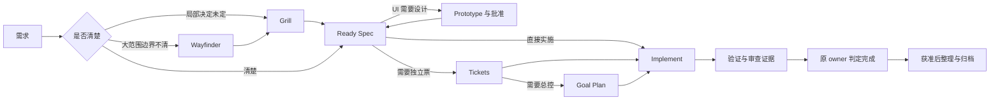

# SpecDev：从需求到实现、审查与交付

[手册首页](../README.md) · [领域目录](README.md) · [领域源入口](../../template/workflows/specdev/SKILL.md)

SpecDev 管理软件开发中的决定、规格、实施和证据。你不需要先学会所有术语，也不需要每次创建全部文件。先说明目标、已有材料和允许做到哪一步，再选择当前需要的 Work。

## 先选路线

| 当前情况 | 建议入口 | 为什么 |
|---|---|---|
| 刚接触项目，想知道怎么构建和测试 | [Init Setup](#init-setup) | 先查真实代码和环境 |
| 大方向有了，但不知道该拆成几个独立需求 | [Wayfinder](#wayfinder) | 先画问题与 change 边界 |
| 一个需求已界定，但产品或架构取舍没定 | [Grill](#grill-with-docs) | 通过有依据的访谈达成决定 |
| 要看 UI 或验证规则原型 | [Prototype](#prototype) | 先得到可操作、可检查的候选 |
| 行为目标明确，要写验收标准 | [Spec](#spec) | 把“想要什么”变成可判定合同 |
| 已有规格，需要独立任务、依赖和逐票追踪 | [Tickets](#tickets) | 拆成可独立执行与验收的票 |
| 已获批规格或已有 Ready Ticket | [Implement](#implement) | 可以直接实施，不强制补 Goal |
| 需要跨票或跨 change 总控、持续推进和恢复 | [Goal Plan](#goal-plan) | 统一整体目标、依赖和验收门 |
| 发生 Bug，根因不明 | [Diagnose Bugs](#diagnose-bugs) | 先复现，再用实验确认原因 |
| 想审查提交、PR 或指定文件 | [Code Review](#code-review) | 固定范围并只读审查 |
| 想判断架构或性能是否值得改 | [Review Architecture](#review-architecture) | 先给有证据的候选 |
| 外部 Issue、PR、CI 或版本交付 | [Triage](#triage) | 区分本地开发与远端操作 |
| 学习需求参考、项目代码或外部资料 | [Learn](#learn) | 给新手讲清功能、实现思路和运行机制 |
| 想改进开发过程 | [Retro](#retro) | 从实际摩擦得到可验证提案 |
| 工作已结束，需要整理知识并封存 | [Archive and Consolidate](#archive-and-consolidate) | 先维护现役资料，再归档 |



图是常见路线，不意味着每个节点必跑。只请求审查、诊断或规划时，相应报告本身就可以是本轮终点。

## 文件和术语怎么理解

默认安装下，一次开发活动通常位于 `.agents/speculo/.speculo/specdev/changes/<change>/`。文件按需创建：

| 工件 | 它回答的问题 |
|---|---|
| `README.md` | 这次做什么、整体 Outcome 是什么、从哪里继续？ |
| `spec.md` | 系统对用户、接口、数据应表现为什么？如何验收？ |
| `LOG.md`、`CONTEXT.md`、`ADR.md` | 有哪些讨论、背景与已经接受的决定？ |
| `DESIGN.md`、`prototypes/` | UI 约束、已批准版本和原型证据在哪里？ |
| `tickets-map.md`、Ticket 文件 | 工作怎样拆分、依赖谁、每票由谁负责？ |
| `goal-plan.md` | 整体如何推进、哪些跨任务条件必须满足？ |
| `evidence/` | 实际实现、测试、审查和集成证据在哪里？ |
| `reviews/`、`diagnosis.md`、`learning/` | 独立审查、诊断、代码讲解的结果 |

`AC` 是验收条件，例如“切到已完成筛选后，只显示完成任务”。`Ready` 表示当前输入已足够进入下一步，不表示已经做完。`Outcome` 是整个 change 的 `active / completed / cancelled`；进度由实际 README、Goal 清单或 Ticket/Evidence 负责，不要求你手工维护全局 status 镜像。

简单需求可用 README 承载范围、验收和验证；用户明确要求独立 Spec 或复杂场景则使用完整 Spec。完整 Spec 同样能直接实现，`ready_for_tickets: true` 表示规格就绪，不表示必须真的建票。

<a id="init-setup"></a>
## I · Init Setup：了解项目和必要偏好

**业务 ID：** `specdev/init-setup` · [源入口](../../template/workflows/specdev/specdev-i-init-setup/SKILL.md)

**什么时候用：** 首次进入仓库、不知道测试入口、想了解工程事实，或明确想建立当前项目文档基线。普通 Work 不强制先经过它。

**准备什么：** 项目目录、你关注的模块、已有指令和偏好。能从仓库查到的包管理器、构建命令、默认分支应先查，不需要你逐个填写。

**会得到什么：** 已确认的入口、构建/测试/CI 与工具事实，必要偏好和未知项。只读调用不创建文件；明确要求基线时才写工程文档或导航已有负责文档，不预建虚假 change、空状态和全部知识目录。

```text
使用 specdev/init-setup，只读了解当前仓库的开发入口、测试和 CI。
请列出可以直接验证的命令和无法确定的内容。
```

**下一步：** 目标明确去 Spec，需求取舍未定去 Grill；想生成项目专属工程规范 Skill 时，另行使用 [engineering-standards-builder](../commands/engineering-standards-builder.md)。

<a id="wayfinder"></a>
## W · Wayfinder：探索大需求与拆分边界

**业务 ID：** `specdev/wayfinder` · [源入口](../../template/workflows/specdev/specdev-w-wayfinder/SKILL.md)

**什么时候用：** “把单机工具变成团队产品”这类大目标，连需要哪些 change、有哪些未知都还不清楚。已有清晰 Spec 时通常不需要它。

**准备什么：** 目的地、已有系统、限制和已知疑问。**得到什么：** 探索地图、调查 Ticket、带来源的答案，以及必要的 initiative 与候选 change 边界。

调查票用于研究、原型、访谈或解除调查阻塞，不等于正式实施 Ticket。默认每次会话最多解决一张调查票；绘图会话不同时把调查票标完成。每个被接受的产品 change 拥有自己的决定与规格，共享答案通过来源引用关联。

```text
使用 specdev/wayfinder，探索把当前单人待办应用改为团队协作产品。
先梳理账号、权限、数据隔离和迁移上的未知，画出候选 change 边界。
本轮先形成地图，不实施产品功能。
```

**下一步：** 选一个调查问题继续；边界清晰的 change 再分别澄清、写 Spec。地图完成只说明探索有结果。

<a id="grill-with-docs"></a>
## G · Grill：把一个 change 的关键决定问清楚

**业务 ID：** `specdev/grill-with-docs` · [源入口](../../template/workflows/specdev/specdev-g-grill-with-docs/SKILL.md)

**什么时候用：** 需求范围已经圈定，但行为、角色、失败处理、架构或迁移政策仍有高影响取舍。

**准备什么：** 一个具体 change、已有要求和约束。**得到什么：** 可恢复的设计树、讨论日志、背景和被接受的 ADR；没有实际内容时不为了数量预建空文件。

AI 应先查代码能回答的事实，再问会改变行为和验收的问题。你决定产品偏好，AI 不能替你假定高影响答案。局部材料留在当前 change，不直接提升为永久知识。

```text
使用 specdev/grill-with-docs，澄清“邀请成员加入团队”。
重点确认邀请过期、重复接受、撤销和权限变化的行为，先查现有实现。
```

**完成怎么看：** 关键未决事项有明确决定或阻塞，决定能定位到依据。共识就绪后去 Spec。

<a id="prototype"></a>
## P · Prototype：看得见、能操作的设计与规则验证

**业务 ID：** `specdev/prototype` · [源入口](../../template/workflows/specdev/specdev-p-prototype/SKILL.md)

**什么时候用：** UI 需要比较方向，交互需要验证，或复杂状态/规则值得先做逻辑原型。它不等于修改生产 UI。

**准备什么：** 当前 change、核心用户任务、现有界面/代码或品牌约束。**得到什么：** UI 分支的候选 HTML、comparison、final、设计合同及真实浏览器证据；逻辑分支的规则验证材料。

UI 默认离线，通常给 3 个候选，配置上限为 4；用户明确的数量覆盖这些默认值。先形成可以操作的 HTML，再集中确认。只有明确要求项目内预览才使用对应临时写集。纯后端逻辑原型不强制 UI DESIGN。

```text
使用 specdev/prototype，为当前 change 的团队成员管理页做 3 个离线候选。
复用现有设计语言，覆盖加载、空列表、失败和权限不足状态，完成浏览器检查后给我比较。
```

**完成怎么看：** 候选与 final 可打开，批准对应实际内容版本，设计与源码、浏览器观察一致。后续 Spec/Ticket/Implement 读取已批准设计；原型截图不能替代生产页面验收。

<a id="spec"></a>
## S · Spec：写行为规格和验收条件

**业务 ID：** `specdev/spec` · [源入口](../../template/workflows/specdev/specdev-s-spec/SKILL.md)

**什么时候用：** 已知目标，需要把“做一个功能”变成可测试的外部行为合同。

**准备什么：** 目标用户、要解决的问题、范围、已有决定、代码事实；涉及 UI 时提供有效设计。**得到什么：** 轻量 README 规格或独立 `spec.md`，包含范围、保持项、正常/失败行为、接口数据、非功能要求、稳定编号的 AC 和验证入口。

Spec 讲“为什么、为谁、应当怎样表现”，不负责逐文件施工。每条 AC 要能观察和判定；不能凭空编造性能阈值、错误码或迁移政策。高影响决定没闭合时保持未就绪。

```text
使用 specdev/spec，把已确认的邀请机制整理成规格。
写清正常接受、过期、撤销、重复操作和权限变化的可观察行为，绑定实际测试入口。
```

**下一步：** 已批准且有实施授权，可直接去 Implement；需要独立调度或依赖图再去 Tickets。只要求规格时，产出 Ready 不自动授权实施。

<a id="tickets"></a>
## T · Tickets：把规格拆成可验收的实施任务

**业务 ID：** `specdev/tickets` · [源入口](../../template/workflows/specdev/specdev-t-tickets/SKILL.md)

**什么时候用：** 需要逐票追踪、独立调度、依赖 DAG，或者你明确要求拆票。不要为了“完整流程”给简单任务制造空票。

**准备什么：** Ready Spec 或等价的获批完整合同、实际项目结构与适用 Skill。**得到什么：** `tickets-map.md` 和每张计划型 Ticket，包含背景、目标、非目标、真实 Skill 绑定、写入范围、修改顺序、验证与失败停止点。

票应该是能验收的垂直切片，而不是机械拆成“数据库票、接口票、前端票”。Map 是导航与控制入口，单票状态仍由 Ticket/Evidence 负责。实际并行必须检查依赖、文件与共享资源冲突。

```text
使用 specdev/tickets，根据当前 Ready Spec 拆分实施任务。
按可验收行为切片，标明依赖和写入范围，绑定仓库里真实存在的工程 Skill。
```

**完成怎么看：** 每个 AC 都有负责验证的任务，当前可执行票通过 Ready 检查。少量线性 Ready 票可直接交 Implement；总控复杂时再用 Goal Plan。

<a id="goal-plan"></a>
## P · Goal Plan：规划、持续推进和恢复整体目标

**业务 ID：** `specdev/goal-plan` · [源入口](../../template/workflows/specdev/specdev-p-goal-plan/SKILL.md)

**什么时候用：** 你想要一个明确目标计划，或者多票、多 change 需要依赖、阶段验收、整体收口。它不负责探索模糊需求，也不替代拆票。

| 模式 | 用途 |
|---|---|
| `plan` | 默认；生成计划，尚未授权实施 |
| `run` | 按已授权范围开始执行 |
| `resume` | 回读检查点后继续原计划 |
| `replan` | 输入变化后调整受影响部分 |
| `verify` | 核对整体目标与完成门 |

简单无票 Goal 可以直接用任务清单；完整模式用既有 Ticket/Map，多 change 则用父 Implementation Plan/Map。Lead 负责正式状态、证据和整体验收。票全 done 不等于整体目标自动完成。

```text
使用 specdev/goal-plan，以 plan 模式为这两个 Ready change 制定整体交付计划。
说明依赖、可以独立推进的部分、整体测试与停止条件，先交付计划。
```

之后可以明确请求 `run`，或说“使用 resume，继续这个计划路径，先核对 HEAD、输入和未闭合动作”。已授权执行会继续下一 Ready 任务，不需要你逐票说“继续”；局部阻塞只暂停其依赖分支。

<a id="implement"></a>
## I · Implement：实施并交付验收证据

**业务 ID：** `specdev/implement` · [源入口](../../template/workflows/specdev/specdev-i-implement/SKILL.md)

**什么时候用：** 已有获批 Direct Spec 或 Ready Ticket，并已明确要求实施。既适用于代码，也适用于已授权的文档任务。

**准备什么：** 当前规格或票、适用项目 Skill、明确范围与授权，必要的设计和工作区选择。**得到什么：** 实际代码/文档、相关验证和双轴审查结果、原 Evidence 中的验收记录。无票使用 direct-spec Evidence，不虚构 Ticket。

实施会检查设计、适用的 TDD 红绿回路、真实调用入口与消费者；文档分支替换不适用的代码 TDD，但仍保留预检、审查、权限和完成门。只能对实际验证过的行为宣称完成。

```text
使用 specdev/implement 实施当前获批 Spec，直接实施，不拆 Ticket。
按当前 App 正常执行，沿现有测试验证每条 AC，并返回改动、结果与未验证项。
```

**完成怎么看：** 每条 AC 有证据，发现的问题有处置，最终候选与验证对象一致。提交、集成、推送的权限按实际授权分别核对。

<a id="code-review"></a>
## C · Code Review：只读审查固定范围

**业务 ID：** `specdev/code-review` · [源入口](../../template/workflows/specdev/specdev-c-code-review/SKILL.md)

**什么时候用：** 要评估文件、一次提交、两个端点、相对基线的变化或 PR。明确本地文件审查不要求 Git；PR 请求不能被降级成随意读几个文件。

**准备什么：** 精确文件清单，或 commit/range/base/head/PR；存在规格、设计、标准时同时提供。**得到什么：** 标准轴和规范轴的独立审查结果；有 change 或获准保存时写报告，否则会话返回。

标准轴看正确性与工程风险，规范轴看是否符合需求和设计。两轴隔离，不能先看对方 finding。有效空差异返回 `no-diff`，不假称批准；没有规范来源时先说明，按合同处理该轴。

```text
使用 specdev/code-review，只读审查 src/cache.ts 和 test/cache.test.ts。
固定当前文件快照，检查生命周期与取消行为，给出有路径和依据的 findings。
```

审查完成不意味着修复完成。需要修复时另行明确授权实施；实际候选或输入变了，受影响审查证据要重新核对。

<a id="diagnose-bugs"></a>
## D · Diagnose Bugs：确认故障根因

**业务 ID：** `specdev/diagnose-bugs` · [源入口](../../template/workflows/specdev/specdev-d-diagnose-bugs/SKILL.md)

**什么时候用：** 出现具体故障但原因不明，包括竞态、间歇失败和性能故障。**准备什么：** 精确症状、触发步骤、日志、环境和可用测试。

先建立一条确实会失败的“红灯”命令，再最小化复现，用单变量实验区分假设。报告包含触发条件、失败机制、影响、回归测试与必须保持的行为。D 可以保存诊断材料和获准临时探针，但不实施生产修复。

```text
使用 specdev/diagnose-bugs 调查取消上传后偶尔仍显示成功的问题。
先建立捕获这个精确症状的复现回路，再验证假设，输出修复契约。
```

无法安全复现时，可以收集一次性事件证据，但不能把解释写成已确认根因。确认后根据范围进入 Spec、Tickets 或 Implement；缺少可测试接缝时转架构评估。

<a id="review-architecture"></a>
## R · Review Architecture：判断结构和性能改动是否值得做

**业务 ID：** `specdev/review-architecture` · [源入口](../../template/workflows/specdev/specdev-r-review-architecture/SKILL.md)

**什么时候用：** 模块反复改动、接口难用、测试困难，或需要实际性能测量。**准备什么：** 指定模块、痛点和目标；缺范围时 AI 先从真实变更压力找线索。

`report` 默认只读报告；`selected-design` 仅在你选择某个候选并要求深入后进入；`performance` 形成测量卡、原始样本、比较条件与优化候选。报告要说明复杂性如何真正减少，而非只换个目录。

```text
使用 specdev/review-architecture 的 report 分支，评估缓存模块的结构压力。
只保留有调用方、测试和维护成本证据的改进候选，不修改代码。
```

**完成怎么看：** 推荐有收益、代价和证据，或诚实返回“没有高置信候选”。报告不自动生成票或授权重构。诊断已发生性能故障用 D，评估优化空间用本入口。

<a id="triage"></a>
## T · Triage：外部请求与 GitHub 交付

**业务 ID：** `specdev/triage` · [源入口](../../template/workflows/specdev/specdev-t-triage/SKILL.md)

清晰的本地需求可直接用其他 Work。Triage 主要在外部请求与交付边界出现时使用；本地 Spec/Ticket/Evidence 仍是开发权威。

| 模式 | 你什么时候用 | 结果/边界 |
|---|---|---|
| `queue` | 想浏览可处理的外部请求 | 只读候选，不建 change |
| `capture` | 先记录一条待处理事项 | workspace capture，保持来源 Issue open |
| `intake` | 正式接入一个请求 | 冻结来源、分诊和路由 |
| `reconcile` | 本地完成后处理来源 Issue | 按原账本与授权投影结果 |
| `publish` | 把已完成本地 Ticket 投影为 Issue | 不是 npm 包发布 |
| `pr-delivery` | 推进明确的 PR 交付 | 固定 base/head 与逐步回执 |
| `ci-security` | 处理指定 CI/安全告警 | 独立操作记录与原权限 |
| `release-preflight` | 检查包/GitHub Release 是否可发布 | 只读预检与记录 |
| `release` | 执行明确获准的发布 | 保存逐目标回执 |
| `recover` | 继续一个失败或部分成功的操作 | 恢复原记录，先核对远端结果 |

```text
使用 specdev/triage 的 intake，接入我指定的 Issue URL。
核对来源和当前实现，给出本地路由；后续远程写入按具体目标确认。
```

本地完成、push、PR 创建/合并、Issue 关闭、npm 发布是不同事实。远端超时先对账，不因一次失败重复创建；也不把远端交付失败改写成代码尚未完成。

<a id="learn"></a>
## L · Learn：学习与图解

**业务 ID：** `specdev/learn` · [源入口](../../template/workflows/specdev/specdev-l-learn/SKILL.md)

**什么时候用：** 想带着需求学习参考项目或文章、理解本项目某段代码、学习已有 change，或单独读懂外部资料。实现前、开发中和实现后都可以直接使用。

**准备什么：** 想学的对象和问题，例如代码路径、项目/文章链接，或希望先理解的需求；未指定参考时会围绕问题查找可靠资料。change 可选。**得到什么：** 纯 Markdown/ASCII 图解与学习索引，讲清功能、实现思路和运行机制；区分源码事实、作者观点、实际测试验证、类比和推断，按编号持续追加。

指定未归档 change 时保存到其 `learning/`，保留原开发状态；未指定时新建学习 change，本轮讲解交付并验证后标记完成。继续追问沿用原对象，不覆盖旧图解或重开状态。已归档来源只读，通过新学习 change 保存讲解。

```text
使用 specdev/learn。我想给本项目增加离线同步，先讲解我提供的参考项目和文章：
它们有哪些功能，数据如何流动，为什么采用这种实现思路，哪些条件下值得借鉴。
本轮先学习；理解清楚后我再决定是否进入需求设计。
```

```text
使用 specdev/learn，讲解本项目 src/transaction.ts 的职责和恢复流程。
把我当成零专业背景读者，先画全图，再解释每条箭头。
```

```text
使用 specdev/learn，解释当前 change 中“取消请求”的完整调用链。
把我当成零专业背景读者，先画全图，再解释每条箭头。
```

学习完成表示本轮材料已交付，不等于用户已掌握，也不会自动启动规格、任务规划或实现。需要系统课程、作业或周期复习时转 [Learning](learning.md)。

<a id="retro"></a>
## R · Retro：复盘开发过程

**业务 ID：** `specdev/retro` · [源入口](../../template/workflows/specdev/specdev-r-retro/SKILL.md)

**什么时候用：** 需求来回、CI 不稳、交接遗漏或协作重复等已经发生的摩擦。**准备什么：** 活动范围、相关 change/测试/日志/交接材料。

**得到什么：** `RETRO-###.md`，区分已观察因果和未验证解释，每项建议有修改位置、owner、正反验收和后续路由。无发现或证据不足也是合法结论。

```text
使用 specdev/retro，复盘这次需求反复和测试遗漏。
依据现有记录区分规则缺失、检查未接入和环境问题，提出可以验证的改进。
```

已完成/归档来源通过新 review change 引用，不能重开原对象。它不自动修代码、提 Issue 或改永久知识；Speculo 产品反馈用 [command/retro](../commands/retro.md)。

<a id="archive-and-consolidate"></a>
## A · Archive and Consolidate：整理现役知识与封存

**业务 ID：** `specdev/archive-and-consolidate` · [源入口](../../template/workflows/specdev/specdev-a-archive-and-consolidate/SKILL.md)

**什么时候用：** 已完成或取消的 change 需要收尾；也可独立审计/维护 ADR、context 和当前工程 docs。明确要求从代码访谈形成知识时才走 `consolidate-from-code`。

归档先检查原完成证据和未闭合交付，给出 change、ADR、context、docs 四类结论，涉及 UI 再检查 DESIGN。先完成获准的现役维护，再整体移动到 `specdev/changes/archive/<change>`，名称保持稳定。

```text
使用 specdev/archive-and-consolidate，对这个已完成 change 做归档 dry-run。
列出四类资产和相关设计的处理计划、未闭合交付、实际移动范围与恢复边界。
```

`dry-run` 只返回计划。已有有效批准可复用；未批准的永久知识写入和移动不执行。归档后原件只读，纠错用后继记录；取消也必须保留已落地影响、writer 处置和真实决定。

## 执行方式与工作区

这是两个独立选择：

| 执行方式 | 说明 |
|---|---|
| 未指定 | 按当前 App/CLI 宿主正常执行 |
| 明确指定 CLI 交互或调用 | 按用户要求与实际接口选择交互/非交互方式 |
| 明确指定 Herdr | 按项目 Skill 和当前工具指南编排多个 AI CLI |

| 工作区 | 说明 |
|---|---|
| `current`（默认） | 当前工作副本；同一时刻只有一个代码 writer |
| `required` | 每个独立实现单元使用 source worktree，并在 candidate 中验证后集成 |

完整 Spec 不拆票也可以用 worktree，整个 change 是一个实现单元。只读审查不为此创建实现 worktree。使用 worktree 需要核对实现提交和本地集成授权，清理仍是单独动作。

```text
按当前 App 正常实施这个 Ready Spec，使用独立 worktree。
先列清所需的本地提交、候选验证与集成动作，复用我已有的对应授权。
```

```text
这个 change 的实现采用 Herdr，审查也采用 Herdr。
工作区使用 current，保持单代码 writer；按所选工具的当前指南执行。
```

选择 Herdr 后才按需获取项目 `.agents/skills/herdr/`，指定上游为 `NAMEWTA/wta-skills-hub` 的 `skills/automation/herdr/SKILL.md`；已有有效包复用，冲突不覆盖。安装与受管会话检查分别进行，`HERDR_ENV=1` 等运行条件仍须满足。具体流程见 [Herdr 方法](../../template/references/coordination/modes/herdr.md)。不必因为安装 Speculo 就安装 Herdr。

## 三个完整练习

**小功能：** Spec → 认可规格并明确实施 → Implement → 阅读 Evidence → 必要时 Learn Change → 获准后归档。无需为线性需求增加 Ticket 或 Goal。

**复杂 UI：** Grill 澄清行为 → Prototype 形成可操作设计并批准 → Spec 绑定设计与 AC → Tickets 划分垂直切片 → 必要的 Goal 总控 → Implement 与真实页面验证 → 收尾。设计变更会使相关批准与证据失效，不能只修改文字保持“已通过”。

**线上 Bug：** Diagnose 收集与复现 → 确认根因及回归条件 → 必要的 Spec/Ticket → 明确授权 Implement → 验证修复 → Triage 或 OPS 处理单独的发布/部署请求。不能把诊断、代码完成和上线混成一个状态。

## 不安装 CLI 时如何使用

普通 SpecDev Work 支持明确的项目根、方法资源根和获批数据根。告诉 AI 方法来自哪个本地 Speculo `template/`，要修改哪个项目，产物允许保存在哪里；数据根是各领域的共同父根，SpecDev 会在其下使用 `specdev/`。

```text
请使用我提供的 Speculo 方法目录中的 specdev/spec。
目标是当前项目；方法资源根是本地 Speculo 仓库的 template；
业务数据根使用当前项目的 .speculo-data。先确认这些实际路径，再编写规格。
```

这不意味着安装专用 `doctor/resolve/recover` 能在没有 workspace 时运行，也不放宽其他领域的初始化要求。如果宿主连本地方法文件都不能读，使用 [Canonical](../canonical.md)。
